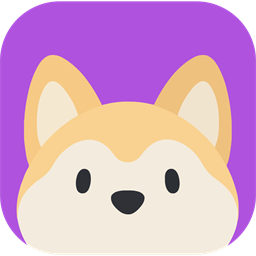
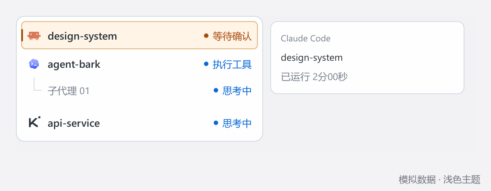
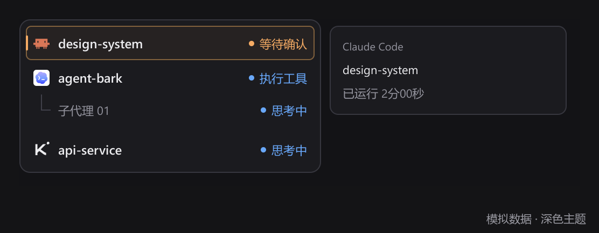
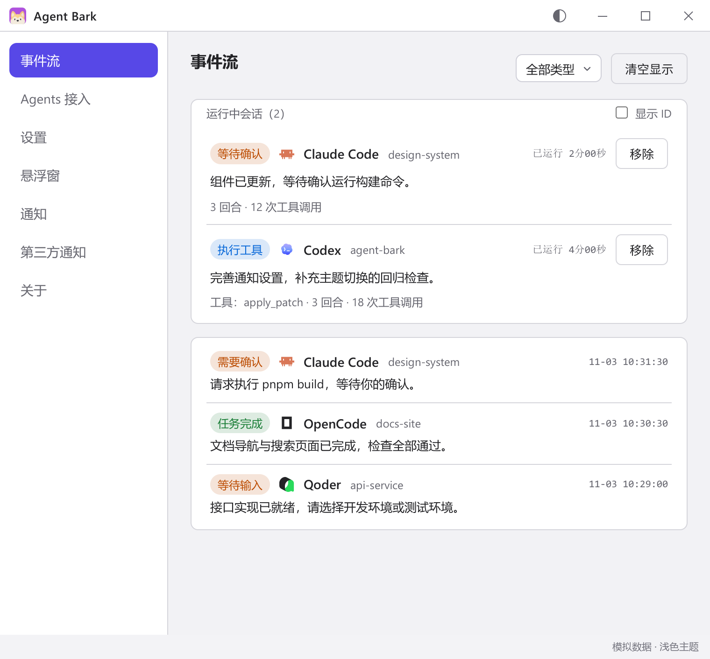
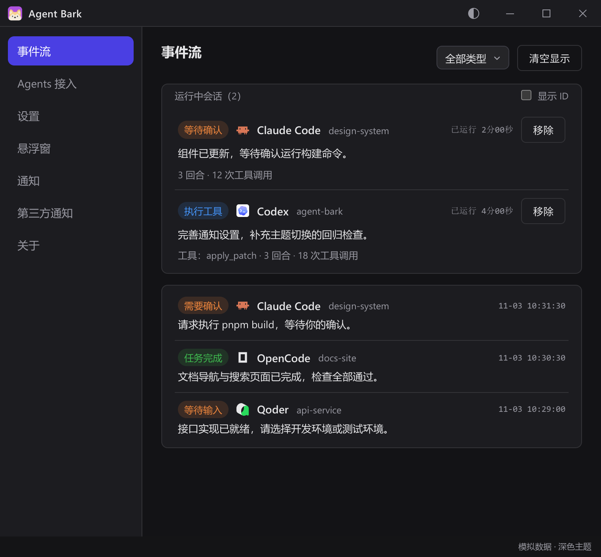
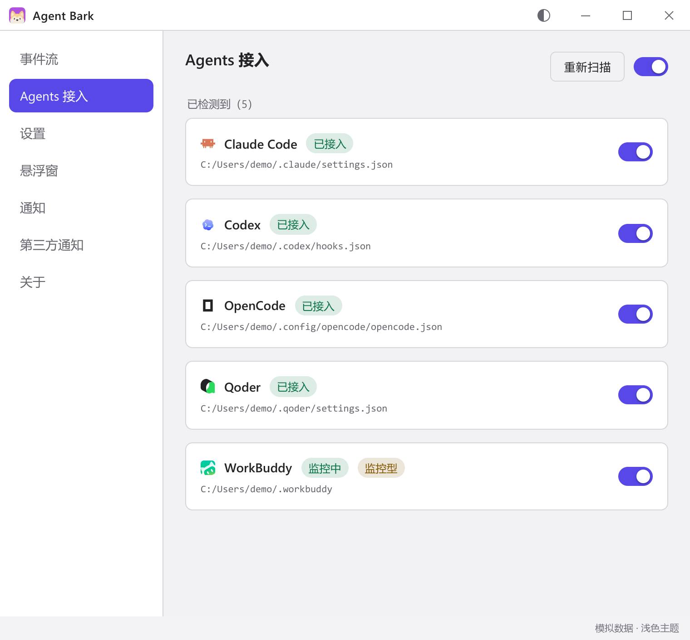
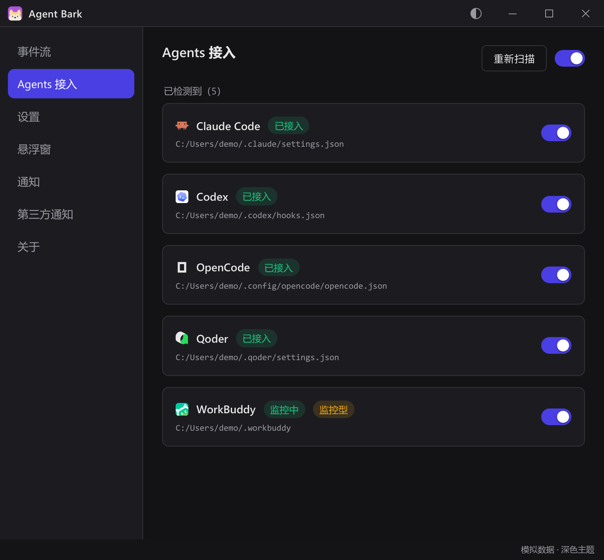
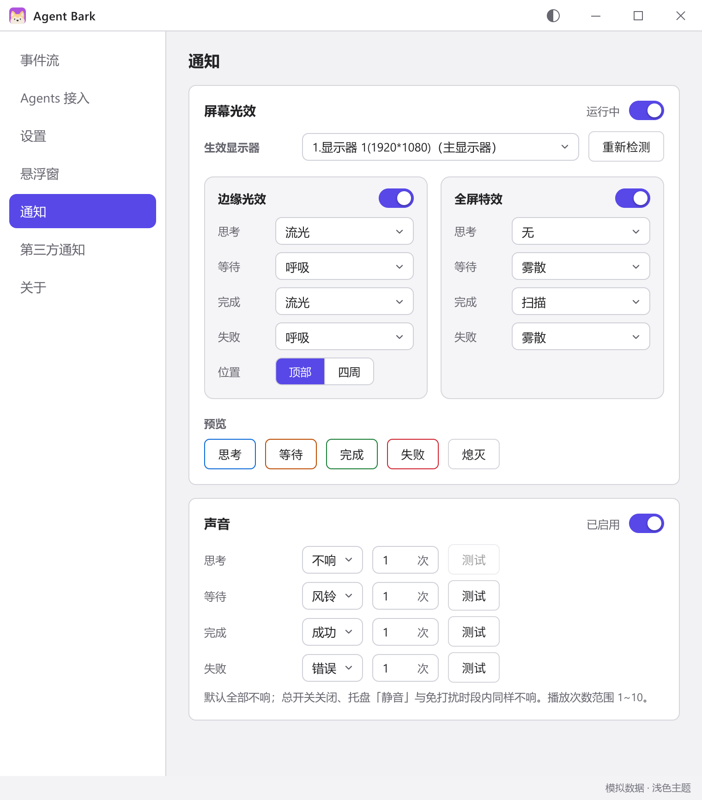
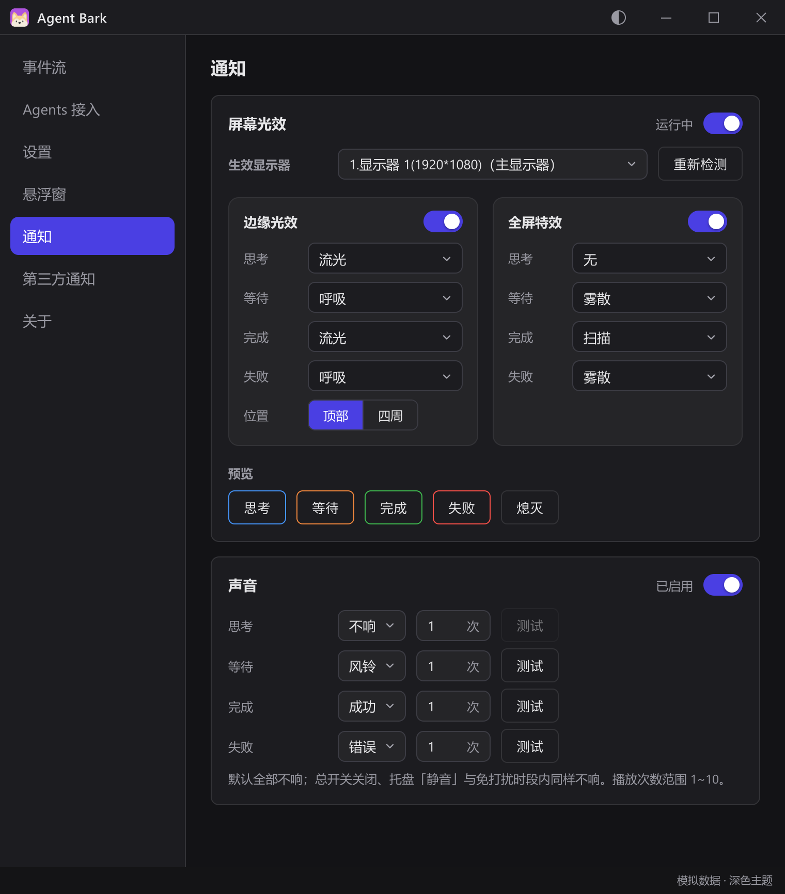

  

<h1 align="center">Agent Bark</h1>

<strong>让 AI 编程助手主动「叫」你回来</strong>

  在桌面查看多个 Agent 的运行状态。 
  需要确认、等待输入、任务完成或失败时，通过光效、声音或消息推送提醒你。

  
  
  
  

  <a href="doc/getting-started.md">快速开始</a> ·
  <a href="doc/agent-integration.md">Agent 接入</a> ·
  <a href="doc/usage.md">使用指南</a> ·
  <a href="doc/configuration.md">配置参考</a> ·
  <a href="doc/development.md">开发构建</a>

## 功能特性

- **多 Agent 接入**：通过 Hook、插件或本地监控接入编程助手，在界面中统一扫描和开关接入。
- **事件流与状态跟踪**：集中查看思考、工具调用、等待确认、等待输入、完成、失败和已终止等状态，支持筛选和本地移除显示。
- **桌面悬浮窗**：显示多个项目和会话，支持父子任务层级、拖动移动、固定位置，以及拖到屏幕顶部/左右边缘后贴边隐藏。
- **贴边自动展开**：鼠标移入贴边区域时展开，移出后收回；新会话或状态变化会临时展开约 5 秒，托盘单击也能找回悬浮窗。
- **光效与声音提醒**：按状态配置边缘光效、全屏特效和提示音，可选择显示器、光效样式、音效与播放次数，并支持预览。
- **第三方通知**：支持 Bark 和通用 Webhook，可接入飞书、企业微信、钉钉、ntfy、Server酱等通知服务。
- **托盘常驻与免打扰**：主窗口关闭后继续驻留托盘，支持开机自启、静音、聚合重复事件和跨零点免打扰时段。
- **主题与位置记忆**：支持浅色/深色主题，主面板与悬浮窗同步切换；悬浮窗位置与停靠位置在重启后恢复。

### 支持的 Agent

| 接入方式 | Agent |
| --- | --- |
| Hook | Claude Code、TRAE（原 TraeCode）、CodeBuddy、Qoder / Qoder CN、Codex、ZCode、Gemini CLI、Qwen Code、Factory Droid、Grok CLI、Cursor、Copilot CLI、Antigravity、Kimi Code |
| 插件 | OpenCode、DeepSeek Harness |
| 本地监控 | WorkBuddy、TraeWork、Kimi Work、豆包工作 |

配置方法与注意事项见 [Agent 接入文档](doc/agent-integration.md)。本地监控属于非官方适配。

## 快速开始

1. 从[发布页](https://github.com/DashingMonkey/agent-bark/releases)下载 Windows 安装包，安装并启动 Agent Bark。
2. 打开「Agents 接入」页，开启对应 Agent，并按提示完成信任或重启；本地监控型确认显示「监控中」。
3. 在 Agent 中发起任务，到「事件流」确认状态；在「悬浮窗」启用桌面卡片，拖到顶部或左右边缘即可贴边隐藏。
4. 在「通知」设置光效与声音；需要手机或其他应用提醒时，进入「第三方通知」配置 Bark 或 Webhook。

首次使用见[快速开始文档](doc/getting-started.md)，悬浮窗、托盘和提醒规则见[使用指南](doc/usage.md)。

## 界面预览

以下图片使用真实界面与模拟数据，支持点击查看大图。

### 悬浮窗与会话详情

| 浅色 | 深色 |
| :---: | :---: |
|  |  |

### 事件流

| 浅色 | 深色 |
| :---: | :---: |
|  |  |

### Agent 接入

| 浅色 | 深色 |
| :---: | :---: |
|  |  |

### 光效与声音

| 浅色 | 深色 |
| :---: | :---: |
|  |  |

---

基于 [MIT 许可证](LICENSE) 开源。
