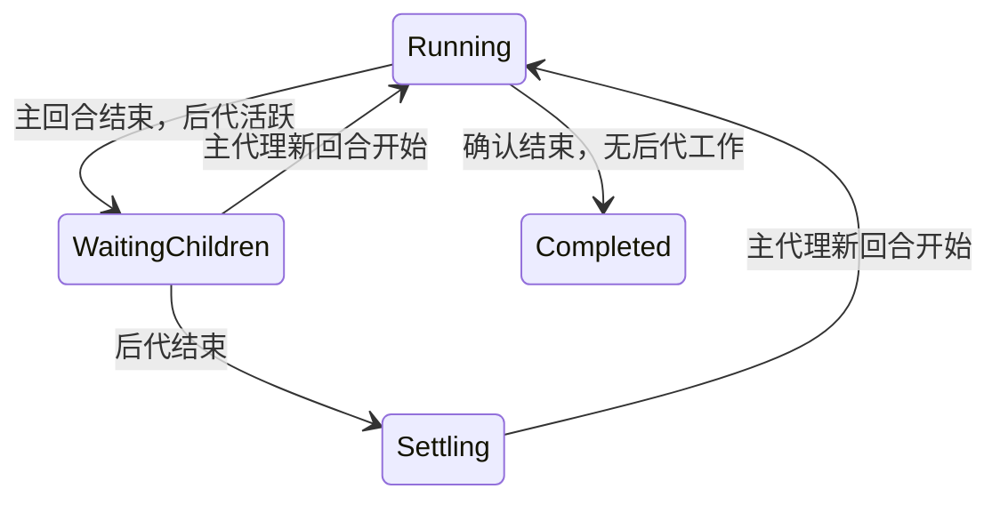

# 父子任务状态

公共判定位于 `app/src-tauri/src/task_lifecycle.rs`，使用 `state.rs` 的同一份会话表。
不增加后台运行时，不控制宿主执行，也不把“子代理会话仍存在”等同于“子代理仍运行”。

## 状态与提醒

| 状态 | 含义 | 完成提醒 |
| --- | --- | --- |
| `thinking` / `tool_running` | 当前回合正在执行 | 无 |
| `waiting_children` | 主回合结束，但后代仍有工作 | 无 |
| `settling` | 回合候选等待确认，或后代已结束、主代理尚未续跑 | 无 |
| 最终完成 | 当前主回合确认结束，且没有阻塞后代 | 一次 |

等待子代理、等待汇总使用中性色，不冒充等待用户操作。真实权限/输入请求保留原有提示。
后台仍有实际运行的子代理时，边缘光效表达运行；只有暂停的父行时静默收起。
子代理行继续展示。以后可以只调整前端标签为“已暂停”，或隐藏子行，内部判定不变。



## 适配器协议

沿用 `parent_session_id`，增加可选 `run`：

```json
{"turn_id":"turn_2","boundary":"finished","children_active":false}
```

- `started`：真实回合开始，必须使用该会话内稳定且不复用的回合标识。
- `progress`：同一回合的工具、权限等事件。纯续命仍用 `keepalive`。
- `candidate`：尚可继续运行的结束提示，例如 ZCode Stop hook；不能发完成提醒。
- `finished`：宿主确认的回合边界，与 `run_completed` / `run_failed` / `run_aborted` 配合。
- `children_active`：可选的来源权威快照，true 表示后代仍在运行，false 表示后代已结束；
  未提供时使用公共血缘表。传输重试不是活跃工作，来源确认的 false 可纠正迟到的子终态。

提供 `run` 即启用公共判定。其他适配器不提供该字段时保持原行为。
主/子事件必须保持来源顺序和来源时间；身份不匹配的旧回合事件不能覆盖当前回合。
子树按 `agent + session_id` 隔离并防环，不按目录、工具名称或子代理标记猜父会话。

DSH 插件负责日志对账、回合身份和可靠重投，完成暂扣移至公共层。更新插件后需要
重新加载 DSH 进程；应用启动时的既有插件对齐机制负责更新部署文件。

ZCode 由日志有序读取主/子回合边界，Stop hook 保存摘要但不是最终完成。
自动汇总不发用户输入 hook，因此必须用日志 `turn.started` 恢复主代理运行状态。

## 生命周期与副作用

状态机设置输出字段 `completion_deferred`。事件历史保留原始完成候选并标注暂扣；
推送、音效、全屏特效及悬浮窗完成驻留均跳过它。调用方输入的此字段不作为判定依据。
真实新回合会撤销旧暂扣；还在通知聚合窗口内的旧完成也会取消。

曾因活跃后代暂扣的已确认回合，不因后代数归零而补发。必须观察到父代理续跑并结束。
失败和用户中止不暂扣；子代理失败不会直接把父任务标成失败。
待完成状态附着在现有会话条目上，关闭接入、失联淘汰、退出应用时随条目清理。

## 可观测性边界

当前适配的 DSH、ZCode 后台子代理会唤醒父代理。若未来适配器的任务是独立后台任务，
或不会回传结果，不能直接套用这一等待策略，需要先定义该宿主的任务完成事实。

观察器首次启动和日志轮转从末尾开始，不能完整重建此前的子树；缺失回合号、父子关系、
日志边界或丢失的开始事件均可能降低准确性。已扣住的完成不会通过固定延时推断为成功；
无法观察续跑时保留等待状态，最终沿用失联清理机制。它不是宿主完整任务队列的权威副本。

## 验证

回归覆盖父完成先到、最后子代理结束后等待汇总、父新回合与迟到旧终态、多层子代理、
候选 Stop 在同回合继续、失败/中止、纯心跳、旧适配器兼容、生产者后代事实，以及
ZCode 原始日志到公共状态表的顺序回放。DSH Node 仿真验证插件上报原始边界而不再补发旧完成，
子终态重投不计为活跃工作。光效回归覆盖只有暂停父行时收起、子代理运行与用户请求的优先级。
